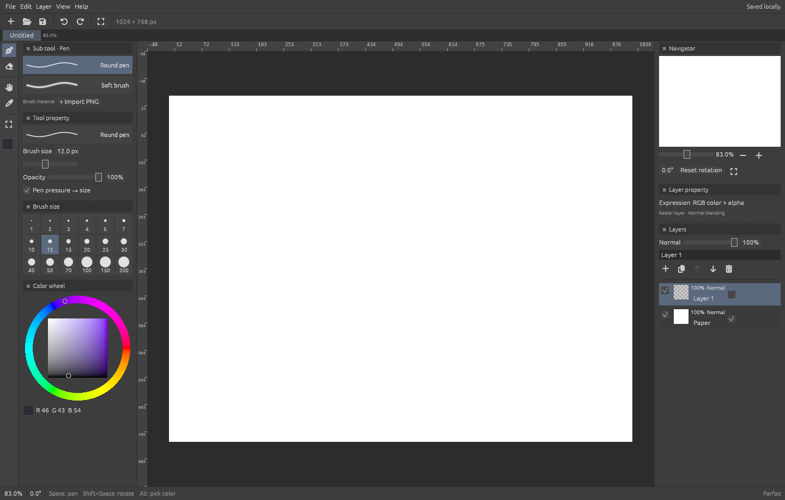

# Parfait

A lightweight, open-source drawing app in Rust. A quiet canvas, familiar pen-first controls, layers, and automatic local recovery.

**Early desktop prototype (0.1).** The first version prioritizes a complete draw → save → restart workflow over a large tool catalog.



## Product direction

Prioritize immediate strokes, low resource use and reliable recovery. Drawing stays local and offline; a future optional community will let creators share brushes and materials. See the [project vision](docs/vision.md) and [performance evidence](docs/performance.md).

## Platform direction

Windows, macOS and Linux are first-class desktop targets. Mobile apps are planned after the desktop foundation, with Android and iOS/iPadOS as intended targets. The Rust drawing core and project format should be shared across platforms; input, lifecycle, file access and UI layout must adapt to each device.

The current prototype has been built and tested on Windows only. macOS, Linux and mobile support are goals, not verified release claims. See the [platform plan](docs/platforms.md) for status and acceptance criteria.

## Try it

Install a current stable Rust toolchain and the platform build tools, then:

```sh
cargo run -p parfait
```

On Windows, the standard MSVC toolchain requires Visual Studio C++ Build Tools. The GNU toolchain also works with MinGW on PATH. The app uses native egui/eframe and OpenGL; no browser runtime is required.

```sh
cargo build --release -p parfait
cargo test --workspace
```

Run an isolated session with `parfait --data-dir PATH`. Otherwise recovery data lives in `%LOCALAPPDATA%/Parfait` on Windows, `$XDG_DATA_HOME/Parfait` or `~/.local/share/Parfait` on other desktops. Only one app can write a given recovery folder at a time.

## In this version

- Round and soft brushes, eraser, size and opacity, color picker and palette.
- Import PNG brush tips: alpha masks for transparent PNGs; inverted luminance for opaque PNGs.
- Raster layers: add, duplicate, remove, reorder, rename, show/hide, lock, opacity and 14 blend modes.
- Bounded undo/redo with copy-on-write pixel snapshots.
- Pan, cursor-centered zoom, view rotation, fit view and navigator preview.
- Local `.parfait` projects, PNG export, background autosave and startup recovery.
- Dark workspace: tools on the left, canvas in the middle, navigator and layers on the right.
- Compact desktop palettes: icon tool rail, brush previews and size presets, hue/SV color wheel, canvas rulers and live layer thumbnails.
- Draggable palettes: reorder or move between side docks, dock side by side, detach into in-app palettes or independent desktop windows, resize and restore your layout on restart.
- Six built-in brush presets, persistent local brush library, batch PNG/JPEG tip import and portable `.pbrush` preset import/export.
- Editable pressure curve, pressure-driven size/opacity, minimum size, flow, spacing, hardness, tip angle/roundness and smoothing.
- Application-owned title bar with window dragging, maximize/restore, minimize, resize edges and save-aware close.

## Workspace and brush settings

Drag a palette's **≡ header** to move it: the actual palette follows the pointer with its current width and body height. Docked and floating palettes use the same compact header and content; floating palettes have no extra window title bar. Drop near the left/right quarter of a docked palette to place it beside that palette in the same row; the center upper/lower half inserts a row above/below. The filled blue rectangle previews the resulting footprint. Drop at the left/right app edge to append to that dock. Press **Escape** during a move to restore its original placement.

The small **− / +** button collapses or expands the body without losing its height; **×** hides the palette. Reopen it from **View → Palettes**. These controls work in both docked and floating states, and visibility/collapse state persist on restart. Floating palettes remain inside the app window. To create an independent desktop window, right-click a palette header and choose **Open in separate window**. Drag its header to move the OS window; use **Dock on left/right** or **Float inside main window** in the same menu to return it. Closing that window hides only its palette, which can be reopened from **View → Palettes**. Native window position/size are saved separately from in-app floating position. Windows creation and close were checked; macOS/Linux native behavior still needs validation. Drag the bottom grip vertically to resize a docked body; in a floating palette or separate window the grip resizes width and height. Rows share width evenly; a dock expands to fit side-by-side panels up to its width limit, then scrolls horizontally. Drag a dock boundary to resize the dock. **View → Reset palette layout** restores the defaults. See the [UI system](docs/ui-system.md).

Layout, active brush settings and the local preset library are saved to `preferences.sqlite` in the recovery directory approximately once per second while not drawing, and on normal exit. Artwork remains in its separate recovery database. Settings changed immediately before a forced termination may not yet be saved.

Response graphs share a compact square editor with grid lines, percentage labels and square control points.

In **Tool property / Pressure**, choose **Pressure curve** and drag the five graph nodes vertically. Linear, Soft and Firm are starting points. Pressure can drive size, opacity or both. The indicator reports whether pressure samples have arrived. Windows uses the backend's Windows Ink/pointer pressure path; tablet drivers need to deliver those events (legacy Wintab-only mode is not implemented). Mouse input uses full pressure. Physical tablets and Linux/macOS pen backends still require hardware verification.

Use **Tool property / Pressure → Curve… → Calibrate tablet…** to open the device calibration window. Draw light and firm strokes in the test pad, then choose **Suggest from strokes**. The suggestion maps the measured 95th percentile to full output and requires at least 20 varied pressure samples; mouse input only previews and cannot generate a suggestion. Click the graph to add a point, drag it in both axes, or delete the selected interior point (up to 16 points, monotonic response, fixed endpoints). Preview strokes update immediately with the draft curve. **Apply & close** saves the calibration; **Cancel / close**, Escape or the title-bar × discards it. Action buttons stay above the scrollable content, including at the minimum window size; the main window controls remain available. **Reset curve** restores an identity draft. Curves smoothly pass through their control points, using the same interpolation for display and actual pressure. This global device curve runs before individual brush curves and does not modify brush preset files. You can also open the window on startup with `--calibrate-pressure`.

Use **Sub tools → Import** for multiple PNG/JPEG tips or `.pbrush` files; **Save preset** updates the named preset or creates one. Export includes tip data and settings. Imported tips are limited to 256 × 256, individual files to 16 MiB and the library to 64 presets. Proprietary brush formats and exact cross-engine brush matching are not implemented.

Ctrl/Cmd + Plus/Minus no longer scales the UI. Space + pointer drag pans; pressing Space during a stroke ends drawing before navigation and drawing resumes only on a new pointer-down.

## Controls

| Action | Shortcut |
| --- | --- |
| Brush / eraser | B or P / E |
| Brush size | [ / ] |
| Move canvas | Space + drag, or middle-button drag |
| Rotate view | Shift + Space + drag |
| Zoom view | Ctrl + `+` / `-` (`=` also zooms in); wheel or Ctrl + wheel at cursor; Ctrl + Space + drag |
| Pick canvas color | Alt + click |
| Fit and reset rotation | Ctrl + 0 |
| Undo / redo | Ctrl + Z / Ctrl + Y or Ctrl + Shift + Z |
| Add layer | Ctrl + Shift + N |
| New / open | Ctrl + N / Ctrl + O |
| Save / save as | Ctrl + S / Ctrl + Shift + S |
| Export PNG | Ctrl + Shift + E |
| Hide side panels / help | Tab / F1 |

Keyboard shortcuts pause while editing a text field. View transformations do not alter image pixels.

## Recovery contract

An unnamed drawing is protected from the first edit. Completed strokes request an immediate background save; longer edits request a snapshot approximately every 400 ms. Pending work is coalesced so slow disks cannot create an unlimited queue.

The UI shows **Saved locally** only after the worker confirms a committed SQLite transaction. Three checksum-verified compressed snapshots are retained. An invalid newest payload falls back to an earlier valid generation, and the app reports that fallback. An unrecoverable database produces an error rather than silently starting over.

An unexpected exit restores the latest valid committed snapshot on next launch. Input not yet committed may be lost. Disk failure and real power-loss durability are not guaranteed by the process-kill tests. Keep exported project backups for important work.

Before New/Open replaces the current drawing, the app creates `before-new.parfait` / `before-open.parfait` in its recovery directory. Those backups are single rotating slots. Save a named project to keep an independent copy. Undo history is session-local; pixel and layer state survives restart.

## Development

See [architecture](docs/architecture.md), [testing](docs/testing.md), and [roadmap](docs/roadmap.md).

```text
apps/parfait/             Native application, panels, input and canvas view
crates/parfait-core/      Raster document, brush engine, undo/redo
crates/parfait-storage/   Versioned SQLite snapshots, worker, recovery tests
docs/                    Architecture, testing, roadmap
```

## Current limits

The prototype starts at 1024 × 768 and uses whole-layer CPU buffers with changed-region CPU compositing and partial texture updates during strokes. Large-canvas tiled rendering is planned. Physical pen pressure/tilt and device-specific behavior still need hardware validation. Cross-window drag docking, nested split layouts, ABR/SUT import, advanced mixing, selection, transforms, and liquify are not implemented. Linux/macOS source portability has not yet been validated on hardware. See the [feature plan](docs/feature-plan.md) for remaining editing tools and UI groups.

## License

MIT. See [LICENSE](LICENSE). Contributions should include source provenance, tests for behavior changes, and no third-party assets without redistribution permission.

Toolbar icons use bundled Font Awesome Free 6.7.2 (SIL OFL 1.1 for the font). See [asset attribution](apps/parfait/assets/fontawesome/README.md) and Help → Third-party notices in the app.

### Layer blend modes

Choose the active layer's mode in the Layers palette, beside opacity: Normal, Multiply, Screen, Overlay, Darken, Lighten, Color dodge, Color burn, Hard light, Soft light, Difference, Exclusion, Add and Subtract. Modes affect the canvas, navigator and PNG export; changes support undo/redo and persist in projects and recovery snapshots.

Older projects open with Normal layers. Saving writes format v2, which older Parfait builds cannot open. Blending currently uses stored sRGB channel values, not linear-light or color-managed compositing.

### Compact brush controls

The Tool property palette shows a cached live stroke preview and four compact rows (size, opacity, flow, smoothing). Drag the numeric values for precision, or use the short sliders. **Details…** opens Brush size, Ink, Brush tip, Stroke and Pressure categories with contextual explanations; **Curve…** opens Pressure directly. Unsupported tip options are disabled. All controls edit the same active brush immediately; **Save preset** updates its library entry. Close, title-bar × and Escape dismiss the detail window without reverting live changes. Device calibration retains its separate Apply/Cancel behavior. Preview size is capped at 56 px and does not simulate pointer smoothing. `--brush-details` opens the editor for UI inspection.
